# NanoVNA-AntExpert

[](https://github.com/jebcampbellhm/NanoVNA-AntExpert/actions/workflows/firmware.yml)

**NanoVNA-H4 only: support current H4 hardware and make antenna tuning a little easier.**

**Current version: 0.1.3** — corrects Smith/impedance calculations and improves
calibration, USB, storage and peripheral error handling, with flash savings.
All standard VNA functions and ANT features remain available. See the
[repair and validation report](doc/reviews/2026-10-22-repairs.md).

Recalibrate **V/U ANT** when upgrading from before 0.1.2; that version changed
its 401-point grid. Updating from 0.1.2 does not require recalibration. HF and
the two-slot ANT1 storage format are unchanged. There is no 2.4 GHz ANT preset.

This antenna firmware requires a **NanoVNA-H4 (STM32F303, 4-inch screen)**.
Do not install the H4 image on a NanoVNA-H, V2/SAA-2, LiteVNA or other model.

NanoVNA-AntExpert builds on [momentics/NanoVNA-X](https://github.com/momentics/NanoVNA-X)
and its ChibiOS runtime. The `antenna_expert` branch adds an antenna-focused
workflow for the **480 × 320 NanoVNA-H4**: readable SWR screens, amateur-band
presets, guided calibration, an eight-band HF overview and cable-length
measurement. The ordinary VNA interface is preserved: the standard VNA screens
and functions remain available, including Smith charts, trace/display controls,
stimulus settings, measurements,
and the ordinary VNA calibration workflow. ANT adds another way to use the H4;
it does not replace the standard VNA interface. The two ANT calibration slots
(5/6) are reserved for the walkthrough; ordinary VNA saves use slots 0–4.

**No SD card is needed** for hardware setup, antenna calibration, saved favorites,
single-band sweeps, tuning, the multiband overview or cable measurement. Settings
and the two ANT calibration profiles live in internal flash. An SD card remains optional for
inherited export and file features.

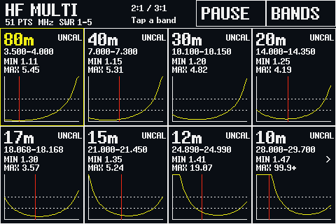

*Unless explicitly labeled as USB captures, screen illustrations use the firmware's fonts and rendering code with synthetic
RF data; they are not measured antenna results. The hardware-mode illustration
uses the production help panel with a host-rendered menu outline.*

## Switch between VNA and ANT

1. From the normal VNA display, **tap the screen or press the roller** to open
   the main menu. Tap **ANTENNA** at the top.
2. From an ANT single-band or TUNE screen, tap **VNA** in the upper-right corner.
   From MULTI, tap **VNA** in its top bar.
   From CABLE, tap **ANT** first to return to the previous band.
3. **Your interface choice is saved between boots:** power off in ANT and it
   starts in ANT; switch to VNA and the next boot starts in VNA. This remembers
   the interface and the last ANT band sweep, MULTI HF or CABLE screen. Measurements
   start fresh; traces are not saved. Single-band sweeps start at 101 points.

An accidental ANT visit followed by **VNA** restores the previous VNA setup.
After selecting a band, turning the band roller or using TUNE/SWEEP, **VNA**
opens that band's exact limits with **CH0 Smith (R+jX) and SWR** traces. Automatic
MULTI scanning does not select a band for this purpose; tapping a card does.

| Normal VNA: open the main menu, then ANTENNA | ANT: tap VNA at the upper right |
| --- | --- |
| 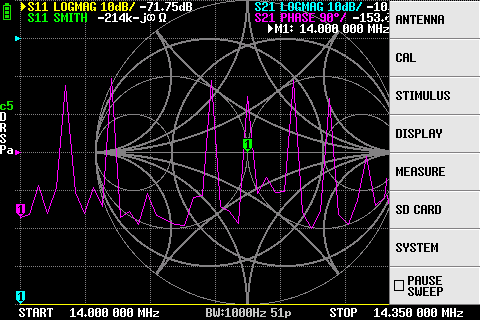 | 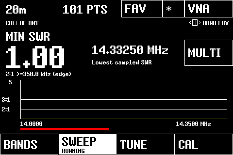 |

The screenshots above are USB captures from the development H4, not mockups.
[View the normal VNA screen without its menu](doc/images/antenna-expert/vna-screen.png).

**CW/data cues:** on MULTI, red vertical lines mark the stored CW/data boundaries
(no line on 30 m). On single-band sweeps, the red bar **below the graph** marks
that portion of the band; the 30 m bar spans the whole band. These use the dated
Extra-class bandplan described in the [operating guide](doc/antenna_expert.md).

## What this branch adds

- **Hardware selection on an unconfirmed H4 installation:** guidance for Direct,
  Div, Multi and ZeeTK, with an explicit **SAVE CONFIG** action.
- **Two protected ANT calibration slots:** HF ANT and V/U ANT, each with **401
  calibration points distributed among its covered bands**, rather than evenly
  across a wide span. HF calibration spacing is at most **10 kHz within each band**.
  V/U includes **EU868 (863–870 MHz)** and **33 cm / US915 (902–928 MHz)**, with
  bandwidth-weighted spacing of about **333–342 kHz** across its seven segments.
  OPEN, SHORT and LOAD can capture both profiles at each step. Updating to 0.1.2
  requires recalibrating V/U; HF from 0.1.0/0.1.1 can be kept. **Clear Config**
  erases both ANT slots along with the other saved settings and calibrations.
- **Single-band SWR:** large minimum-SWR and frequency readouts, 2:1 and 3:1
  guides, bandwidth indication and 101/201/401 measurement-point selection.
  Impedance at the minimum appears as **R ± jX Ω**: resistance and signed
  reactance (`+j` inductive, `-j` capacitive), using the existing ANT calibration.
- **TUNE:** live SWR and impedance at a selected frequency, adjusted with the roller or touch
  buttons. Favorites, the ANT/VNA startup mode and the last ANT band/MULTI/CABLE screen are saved.
- **MULTI HF:** eight cached mini plots for 80, 40, 30, 20, 17, 15, 12 and 10 m,
  each with minimum/maximum SWR. Tap a card for detail and **MULTI** to return.
- **CABLE:** large metre/feet estimates for open-ended cables, adjustable velocity
  factor, quarter-/half-wave targets at a chosen frequency, and three optional
  wide 401-point sweep ranges. Accessible from **BANDS**. **HF CAL** reuses the HF ANT
  profile; entering a covered frequency selects **FREQ CAL** and the matching
  HF/V/U profile. No additional calibration slot is needed. Wide resonance ranges
  retain optional ordinary calibration in RAM or slots 0–4.
- **Bandplan cues:** combined 60 m channel view, CW/data rails in band sweeps,
  and red vertical CW/data boundaries in the overview (omitted on 30 m).
- **Runtime and hardware fixes:** ZeeTK RF settings, startup/capture timing,
  ChibiOS interrupt-exit scheduling for battery operation, roller input,
  protected flash boundaries and USB sweep-data handling.

## Start here

1. Install the image matching your MCU: **H4/F303** for the antenna screens.
   See [easy button-DFU flashing](doc/flashing_h4.md).
2. On an unconfirmed H4 install, match **HARDWARE MODE** to the board/chip
   markings, then tap **SAVE CONFIG**. ZeeTK H4 rev4.4 uses **ZEETK**.
3. Open **ANTENNA → CAL**. Capture OPEN, SHORT and a 50-ohm LOAD where the device
   under test will connect, then save the HF and V/U profiles. For antenna work,
   this is usually the end of a retained measurement lead. To measure that lead's
   own length, calibrate at CH0 instead; calibration removes everything before
   the standards' connection point.
4. Choose **BANDS**, select a band and connect your antenna. Use **TUNE** for a
   particular frequency or **BANDS → MULTI HF** for the eight-band overview.
5. For a cable, choose **BANDS → CABLE**, leave its far end open and set its
   velocity factor. See the [cable walkthrough](doc/antenna_expert.md#6-measure-a-cable-and-calculate-quarter-half-wave-lengths).

Read the [illustrated operating guide](doc/antenna_expert.md) for hardware-mode
selection, calibration coverage, controls and storage behavior.

## Screens

| Hardware setup | Guided ANT calibration |
| --- | --- |
| 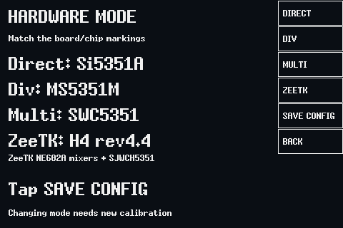 | 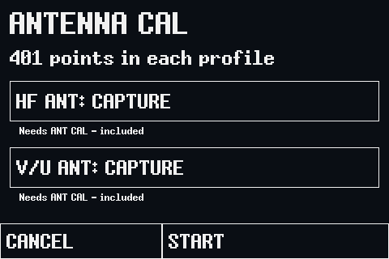 |

| Single-band sweep and MULTI shortcut | Fixed-frequency tuning |
| --- | --- |
| 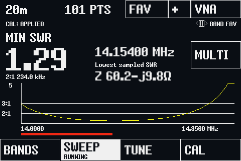 | 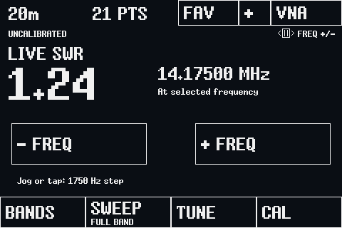 |

| V/U presets including EU868 | EU868 uses the V/U ANT profile |
| --- | --- |
| 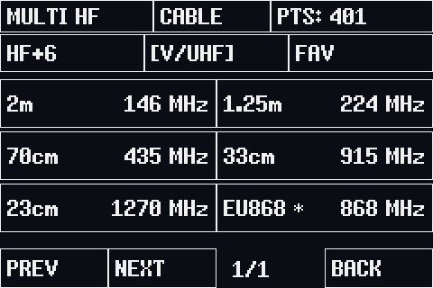 | 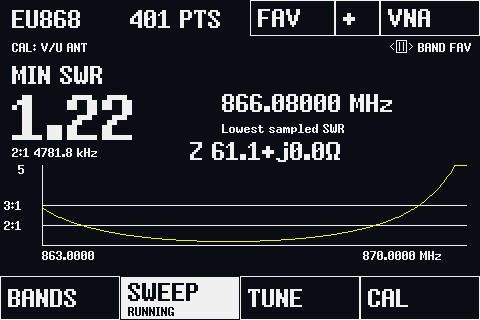 |

| CABLE: reuse HF ANT calibration | FREQ CAL: select the operating band |
| --- | --- |
| 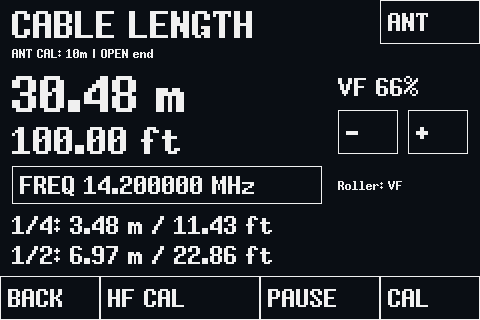 | 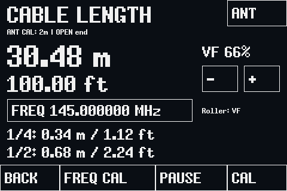 |

**CABLE starts in HF CAL**, measuring reflected phase across 28–29.7 MHz with
401 sweep points. **FREQ** sets the quarter-/half-wave targets and, for a covered
amateur band, switches to **FREQ CAL** with the matching HF or V/U ANT profile.
For example, 7.1 MHz selects 40 m/HF and 145 MHz selects 2 m/V/U. No extra saved
calibration slot is needed. Frequencies in band gaps keep the HF reference
measurement while updating the targets; calibration is never interpolated
across those gaps.

Metres and feet use two decimal places; this display precision is not a promise
of accuracy. **VF** must match the cable. Missing or incompatible ANT calibration
shows **NEEDS ANT CAL** with no length reading. **ANT** returns to the previous
antenna band, then **VNA** returns to the ordinary interface. The CABLE screen
is restored after restart; its measurements, target frequency and range are not.
The [operating guide](doc/antenna_expert.md#6-measure-a-cable-and-calculate-quarter-half-wave-lengths)
explains the calibration connection point, narrow-band limitations and optional
5/50/300 MHz resonance ranges.

## Easy USB update

Power the H4 off, **hold the roller/multifunction button pressed inward**, and
power it on while holding it. Release after startup; a black screen is normal
in DFU mode. Connect a USB data cable and flash **H4.bin** with STM32CubeProgrammer.
Follow the [step-by-step button-DFU guide](doc/flashing_h4.md), including backup,
address and verification instructions. No SD card is involved.

## Hardware and validation

| Target | Scope in this fork |
| --- | --- |
| NanoVNA-H4 / STM32F303 | Antenna UI and hardware-mode guidance. Development and hands-on testing have used a ZeeTK H4 rev4.4. |
| NanoVNA-H / STM32F072 | Automatic builds disabled; upstream source retained. **Not supported for AntExpert; no ANT screens.** |

Select the RF mode from actual component markings; there is no reliable automatic
ZeeTK revision detection. Support for presets through 23 cm does not imply equal
measurement accuracy across that whole range. The US band presets and CW/data
cues follow the supplied March 2024 bandplan; they are measurement aids, not a
current transmission-permission check.

Host tests cover the production UI, calibration grids and OSL processing, cable
phase-delay fits, HF/V/U calibration switching, numeric input, lossless font
decoding, storage protection, sweep snapshots, startup and interrupt handling.
Normal and address/undefined-behavior sanitizer tests run in WSL. Current firmware
validation builds H4 only; earlier development also checked the inherited H target.
Hardware testing has confirmed ANT navigation, saving, multiband display, USB/Saver operation and
battery operation on the development unit. The cable build has been flashed and
readback-verified with saved calibration/configuration unchanged; comparison
against known physical cable lengths is still pending. Quantitative RF accuracy
and coverage on other hardware revisions remain work in progress.

## Build from source

```sh
git clone --branch antenna_expert https://github.com/jebcampbellhm/NanoVNA-AntExpert.git
cd NanoVNA-AntExpert
bash tools/install-arm-toolchain.sh "$PWD/../arm-gnu-14.2.rel1"
export PATH="$PWD/../arm-gnu-14.2.rel1/bin:$PATH"
make test
make TARGET=F303 USE_LTO=yes -j$(nproc)
```

Use Ubuntu/WSL on x86_64. CI and releases pin the official Arm GNU 14.2.Rel1
package (GCC 14.2.1), verified by SHA-256, including its runtime libraries.
Use the same package locally when comparing firmware sizes; distribution compiler
packages can produce different images. The default target, GitHub CI and release
builds are **H4/F303 only**.
The H4 code partition is almost full;
the linker must continue to protect saved calibration storage. Detailed
prerequisites and USB DFU instructions are in [the build guide](doc/building.md).
Firmware is flashed over USB DFU, not by putting a `.dfu` file on an SD card.

## Versions and device information

AntExpert's current product version is **0.1.1**, recorded in `VERSION`.
Version 0.1.1 adds the CABLE workflow, calibration reuse, wavelength calculator,
square decimal glyph and lossless numeric-font compression. All standard VNA
screens and functions remain available. The ANT calibration grid and saved-slot
format are unchanged from 0.1.0: a normal code-only upgrade needs no reset or
recalibration when the calibration connection and RF settings still match.
See the guide for older development-grid upgrades.

Release tags, when published, match the product version, such as `v0.1.1`;
release files use names such as `NanoVNA-AntExpert_H4_v0.1.1.dfu`.

**CONFIG > VERSION** displays AntExpert's version, H4-only support, the Git
revision, build date/time and `github.com/jebcampbellhm/NanoVNA-AntExpert`.
The address is readable text, not a clickable device control. USB `info` includes
the same details. A `-dirty` revision marks a build with tracked local changes.

The USB `version` command deliberately retains the upstream protocol capability
version **0.9.102**, recorded separately in `UPSTREAM_VERSION`. [NanoVNA-Saver uses version thresholds](https://github.com/NanoVNA-Saver/nanovna-saver/blob/main/src/NanoVNASaver/Hardware/NanoVNA.py)
to choose scan commands; sending the separate AntExpert product version there would
make it treat the firmware as an older protocol. Board identification and the
USB shell greeting retain their NanoVNA identity.

## Firmware checksums

CI downloads now include `H4-SHA256SUMS.txt` and `H4-build-info.txt`, recording the
binary/package hashes, source commit, compiler and target. Compare `.bin` with
`.bin`; a `.dfu` container or artifact ZIP has a different hash.

The development H4's cable build was readback-verified before the version bump;
it still identifies itself as 0.1.0. A 0.1.1 build has different version/provenance
bytes, and CI may also use a different compiler and build timestamp. See the
[firmware verification record](doc/firmware_hashes.md) for the flashed image's
hashes and earlier local/CI comparisons. Use the manifest from the specific
download: matching source alone does not imply matching binary hashes.

## Project notes and credits

- [Illustrated antenna operating guide](doc/antenna_expert.md)
- [Implementation notes and development validation history](doc/antenna_mode.md)
- [Easy H4 button-DFU flashing](doc/flashing_h4.md)
- [Build guide](doc/building.md)
- [Archived upstream overview](README_UPSTREAM.md)
- [Licensing and provenance](doc/licensing.md)

This fork is maintained by [@jebcampbellhm](https://github.com/jebcampbellhm).
Thanks to [@momentics](https://github.com/momentics) for NanoVNA-X,
[@hugen79](https://github.com/hugen79/NanoVNA-H) for the NanoVNA-H reference work,
and [@edy555](https://github.com/edy555), [@DiSlord](https://github.com/DiSlord)
and the wider NanoVNA community. Existing copyright notices and GPL licensing
are retained; see [LICENSE](LICENSE).
