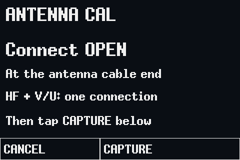
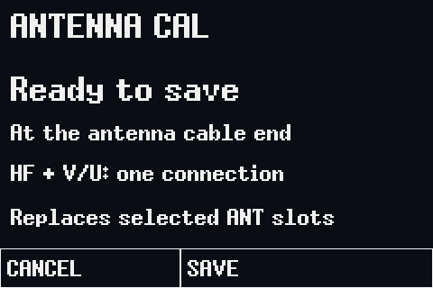
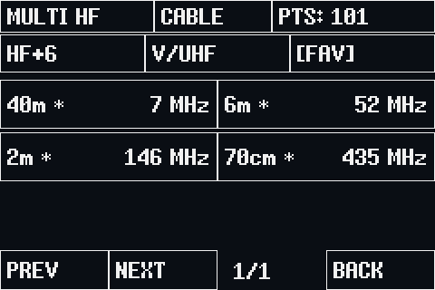

# Using NanoVNA-AntExpert

**H4 only:** the ANT workflow requires NanoVNA-H4 / STM32F303 with its 480 × 320 screen. **No SD card is
required.** Calibration profiles, hardware selection, favorites and ANT/VNA
startup mode use internal flash. Other NanoVNA models are not supported by the AntExpert UI.
Start with the [easy button-DFU flashing guide](flashing_h4.md).

**Version 0.1.1** adds the CABLE screen described below. It reuses the 0.1.0 ANT
calibration profiles without changing their grid or slot format. A normal
code-only update does not require Clear Config or a new calibration when your
connections and RF settings match. Earlier development grids are covered by the
recalibration note in section 2.

These illustrations are generated with the firmware font/rendering code and
synthetic measurements. They show controls and layout, not expected antenna SWR.
The hardware help panel is production-rendered; its menu outline is host-rendered.

## VNA and ANT are two views of the same instrument

The standard VNA screens and functions remain available, including Smith-chart
and trace views, stimulus controls, measurement tools and normal VNA calibration.
ANT is an additional interface. Slots 5/6 are protected for ANT; ordinary saves
continue to use slots 0–4.

Tap the VNA screen or press the roller, then choose **ANTENNA**. To return, tap
**VNA** at the upper right of a single-band or TUNE screen. In MULTI, tap a band
card to open that screen first.
From CABLE, tap **ANT** to return to the last antenna band, then **VNA**.

These two images are actual USB screen captures from the development H4. ANT/VNA
selection and the last ANT band sweep, MULTI HF or CABLE screen are saved automatically
across power cycles. The screen opens with fresh measurements, not a saved trace.
Single-band sweeps restart with 101 points; MULTI scans its eight bands anew.
CABLE restarts in **HF CAL** (28–29.7 MHz, 401 points) with a 14.2 MHz
calculator target. Cable range, target frequency and velocity-factor adjustments
are session settings; a normal VNA calibration save
stores the velocity factor with that slot.
TUNE returns to its band's sweep; band pickers and calibration walkthroughs are
not resumed. A fresh or older configuration without a saved screen starts at 20 m.

Screen changes save settings only when the selected band or view changes;
measurements and automatic MULTI scanning do not write flash. Existing favorites
and calibration slots are preserved. Older firmware does not understand this new
screen/favorites encoding and may return to its default favorites and startup mode
if you downgrade.

## 1. Select hardware on first use

If the saved hardware-confirmation flag is missing, H4 opens this guidance screen
at startup. This includes a fresh installation, cleared settings or older
settings without that flag. Firmware does not infer the RF revision from USB or
MCU identification. Match the board/component markings:

| Selection | Hardware cue |
| --- | --- |
| DIRECT | Si5351A clock hardware |
| DIV | MS5351M clock hardware |
| MULTI | SWC5351 clock hardware |
| ZEETK | ZeeTK H4 rev4.4, NE602A mixers and SJWCH5351 clock |

Choose the matching option and tap **SAVE CONFIG**. Later, reopen it through
**SYSTEM → DEVICE → MORE → MODE**. Changing RF mode clears confirmation and
active calibration; save the selection and recalibrate. The hardware **MULTI**
option is unrelated to the **MULTI HF** antenna overview.

Missing confirmation does not erase existing settings or calibration slots.
Correction stays disabled until the hardware choice is confirmed. Retained old
calibration is not automatically proof that it matches the selected hardware.
For ZeeTK, use **CAL POWER = AUTO** when calibrating.

## 2. Calibrate HF and VHF/UHF together

Open **ANTENNA** from the normal main menu, then **CAL**.

Two protected internal-flash slots are reserved for ANT calibration. Each profile
contains **401 total calibration points**, concentrated in the bands below.
It is not 401 points per band and not one uniformly spaced sweep through the gaps.

| Profile | Internal slot | Covered presets |
| --- | --- | --- |
| HF ANT | 5 | 160, 80/75, 60, 40, 30, 20, 17, 15, 12 and 10 m |
| V/U ANT | 6 | 6 m, 2 m, 1.25 m, 70 cm, 33 cm and 23 cm |

HF uses **10 kHz maximum calibration spacing within each band**, including both
endpoints. The 401 points are allocated as follows:

| Band | Calibration points | Spacing |
| --- | ---: | ---: |
| 160 m | 21 | 10 kHz |
| 80/75 m | 51 | 10 kHz |
| 60 m | 9 | 9.475 kHz |
| 40 m | 31 | 10 kHz |
| 30 m | 6 | 10 kHz |
| 20 m | 36 | 10 kHz |
| 17 m | 11 | 10 kHz |
| 15 m | 46 | 10 kHz |
| 12 m | 11 | 10 kHz |
| 10 m | 179 | About 9.55 kHz |

The VHF/UHF profile retains its wider spacing; the 10 kHz limit applies only to
HF band segments. This is calibration spacing, independent of the screen's
measurement point count.

**Recalibrate after upgrading from the original development grid.** This revision
keeps the ANT1 format and does not automatically reject existing profiles. Set
**both profiles to CAPTURE** and repeat OPEN, SHORT and LOAD before relying on
readings: existing HF coefficients belong to different frequencies. Normal VNA
calibration slots are unaffected.

The displayed slot numbers are the firmware's IDs; normal calibration slots
0–4 remain available. Ordinary calibration saves and USB save commands cannot
write slots 5/6. The ANT walkthrough is their write path.

1. Connect the measurement cable to **CH0**. Attach standards at the cable end
   where the antenna will connect; keep adapters/cable consistent afterward.
   To measure the cable itself in CABLE, instead calibrate at CH0 and attach the
   cable afterward. Length is measured from the standards' connection point.
2. Set each profile to **CAPTURE** or **KEEP**. Missing or incompatible profiles
   are automatically included and cannot be skipped. With both selected, every
   standard is measured over **both** profiles before the next prompt.
3. Tap **START**, connect **OPEN**, then **CAPTURE**. Wait for the SHORT prompt.
4. Connect **SHORT**, tap **CAPTURE**, and wait for the LOAD prompt.
5. Connect the **50-ohm LOAD**, then tap **CAPTURE**.
6. At **Ready to save**, tap **SAVE**. This replaces the selected ANT profiles.

| Capture OPEN | Save both profiles |
| --- | --- |
|  |  |

OPEN/SHORT/LOAD supplies the one-port S11 correction used for antenna SWR.
ISOLATION and THRU are not required for ANT; use the ordinary VNA calibration
workflow for two-port transmission measurements. ANT does not need enhanced
response calibration for this S11 workflow.

Selecting a band automatically loads its corresponding profile and interpolates
within that band's stored calibration segment. The 101/201/401 measurement-point
choice and the 51-point multiband scans reuse these profiles. Gaps between bands
are not calibrated by interpolation across their boundaries; the combined 60 m
segment includes the gaps between its channels. Watch the calibration-status
message rather than assuming any arbitrary VNA range is covered.

Cancel before SAVE leaves stored profiles unchanged. Saving the two profiles is
not an atomic pair: interrupted power during SAVE may leave only one updated.
Retry a reported save failure. **Clear Config erases settings and all calibration
slots, including HF ANT and V/U ANT.** After reset, select and save the hardware
mode again, then run the ANT calibration walkthrough; both empty profiles are
automatically included. ANT profiles include RF compatibility
metadata, and incompatible profiles must be captured again.

## 3. Sweep one band

**BANDS** offers HF+6, V/UHF and FAV lists. Choose a wavelength/frequency tile;
**PTS** cycles 101, 201 and 401 measurement points. The power-on default is 101.
The combined 60 m tile shows the five channel centers on one plot.

- **MIN SWR** is the lowest sampled SWR and its frequency, not necessarily the
  zero-reactance resonance. Narrow dips between samples can be missed.
- The plot has **2:1 and 3:1** guides and a 1–5 SWR scale. Higher values clip at
  the graph ceiling; the numeric value remains visible up to `99.9+`.
- **2:1 width** describes the dip around the minimum. `>=` / `(edge)` means the
  band edge truncates that width.
- A **red rail** beneath HF plots marks the stored Extra-class CW/RTTY/data
  region. It covers all of 30 m.
- **SWEEP** switches between continuous measurement and pause, retaining the
  trace. The button changes appearance and says RUNNING or PAUSED.
- **FAV / ALL** toggles roller navigation through favorites or all bands.
  The separate **+ / \*** button adds/removes and immediately saves membership.
- Roller left/right changes bands; pressing opens/closes the band picker.
- **MULTI**, beside the frequency on an HF band sweep, returns directly to the
  eight-band overview. It is not shown in TUNE or on VHF/UHF band sweeps.
- **VNA** returns to the previous ordinary VNA view. Entering/leaving ANT saves
  which interface should open on the next boot. Returning to ANT restores the
  last band sweep or MULTI HF screen and takes fresh measurements.

## 4. Tune at one frequency

Tap **TUNE** to start at the sampled minimum, or the band center if no completed
sweep is available. Turn the roller or tap **− FREQ / + FREQ** to change the
frequency by the displayed step. In TUNE the roller changes frequency, not band.
The live readout uses the middle sample from a 21-point fixed-frequency capture;
update speed still depends on RF bandwidth and settling. **SWEEP** returns to
whole-band measurement.

## 5. Compare eight HF bands

Enter with **BANDS → MULTI HF** or the **MULTI** shortcut in an HF band sweep.
The initial fixed selection is **80, 40, 30, 20, 17, 15, 12 and 10 m**. All eight
are measured even if they are not saved favorites; a multiband antenna may have
poor matches on some of them.

Each band gets **51 measurement points**, scanned sequentially. Completed plots
stay visible while the next band is measured; values are not simultaneous.
Each card shows its range in MHz, sampled **MIN/MAX SWR**, and CAL/UNCAL status.
Curves share a 1–5 scale with dashed 2:1 / 3:1 lines. A red vertical line marks
the same CW/data boundary used in single-band view; **30 m has no vertical line**.
`!` indicates invalid samples; the curve breaks at them instead of joining them.

- **PAUSE / RUN** stops or resumes scanning.
- **Tap a card** to open its detailed band sweep at the session's chosen point
  count; **MULTI** on that screen returns to a fresh overview.
- **Roller left/right** selects a card; **press** opens it.
- **BANDS** returns to band selection.

The overview reuses the HF ANT calibration and internal working memory. No SD
card, extra calibration file or per-band manual recall is needed.

## 6. Measure a cable and calculate quarter-/half-wave lengths

Open **BANDS → CABLE**. The default **HF CAL** setting reuses the saved HF ANT
profile and measures cable delay across **28–29.7 MHz**, the widest continuously
calibrated HF band. A fit to the change in reflected phase estimates round-trip
delay; physical length is `delay × speed of light × VF / 2`, with VF expressed
as a fraction. The screen shows **metres and feet together, with two decimal
places**, plus target lengths for **1/4 and 1/2 wavelength**.

**No additional calibration slot or recalibration is needed if your saved ANT
profile matches the connection and RF settings.** Length starts at the calibration
reference plane: where you attached OPEN/SHORT/LOAD. If you calibrated through a
short lead, keep that lead attached and connect the cable being measured after
it. To include that lead in the measured length instead, recalibrate directly at
CH0. A calibration made at the far end of an antenna feedline removes that feedline
from the measurement; it cannot then measure the feedline itself.

1. Set the cable's **velocity factor (VF)** from its specification. Turn the
   roller or tap **− / +** below VF to adjust it by one percentage point (1–100%).
   The starting value is the current VNA VF setting (70% after a full reset;
   invalid values fall back to 66%). Incorrect VF gives proportionally incorrect
   physical length.
2. Attach the cable to **CH0**, or after the retained calibration lead, with its
   **far end open**: no antenna or load. A completed sweep supplies a fresh length.
   The header names the calibration band, such as **ANT CAL: 10m**. If its saved
   profile is absent or incompatible, it says **NEEDS ANT CAL** and shows no
   measured length. It does not silently substitute an uncalibrated reading.
3. Tap **FREQ** to enter the desired operating frequency (for example, **7.1**,
   then **M/MHz**). If it lies in a covered band, CABLE switches to **FREQ CAL**,
   loads the matching **HF or V/U ANT profile**, and starts a fresh 401-point
   sweep within that band. For example, 7.1 MHz uses 40 m/HF; 145 MHz uses 2 m/V/U.
   The header identifies the measurement band. Interpolation stays between
   calibration points in that band; it never crosses uncalibrated band gaps.
4. Compare the measured length with the **1/4** or **1/2** target below it. At
   7.1 MHz and 66% VF, these are **6.97 m / 22.86 ft** and **13.93 m / 45.72 ft**.
   The target calculations themselves need no calibration. They describe physical
   cable length using VF, not free-space antenna dimensions. FREQ CAL measures
   average delay across the selected band, not an exact phase null at one frequency.
5. Tap **PAUSE / RUN** to hold/resume the reading. VF adjustments update the held
   length and both targets without another sweep or flash write. Entering a new
   frequency selects its measurement range and resumes the sweep. **BACK** returns
   to BANDS; **ANT** returns to the previous antenna band, whose **VNA** button
   opens the standard interface.

These cable-screen examples use synthetic measurements rendered by the
firmware UI test harness. Actual results depend on the cable and calibration.

The frequency keypad accepts **50 kHz–2.7 GHz**, clamping entries outside that
range. If the frequency is outside the calibrated bands, the wavelength targets
still update, but measurement returns to the explicitly labeled **HF CAL**
reference range. Canceling entry leaves the frequency, sweep and pause state
unchanged. Target frequency and range changes do not write flash.

**FREQ CAL is useful near the operating frequency, but a narrower band is not
necessarily more accurate.** Short cables produce very little phase change in a
narrow HF band, and calibration noise can dominate. A weak reflection, unresolved
slope, excessive phase curvature or nearly aliased phase steps yields `--`.
Try **HF CAL** for its wider HF span, or a wide resonance range for short jumpers.
The displayed decimal places do not establish measurement accuracy.

The range button cycles **HF CAL → FREQ CAL → 5 → 50 → 300 MHz** (FREQ CAL is
skipped if the target is in a calibration gap). In either ANT-calibrated setting,
**CAL** opens the existing ANT walkthrough with the relevant profile selected;
empty profiles are included as usual. After completing or canceling it, return
through **BANDS → CABLE**. Recalibration replaces the selected existing ANT
profile, rather than allocating another slot.

### Optional wide resonance ranges

The **5/50/300 MHz** settings preserve the original cable measurement method:
start at **50 kHz**, collect **401 points**, and find the first resolved quarter-wave
S11 resonance of an open-ended uniform cable. Use 300 MHz for short jumpers and
5 MHz for long feedlines. The first resonance must lie inside the sweep with
enough samples before it. These ranges show **UNCAL** unless an ordinary continuous
S11 calibration covers the range; the segmented ANT profiles are not applied
across their gaps.

For a calibrated wide sweep, select its range, tap **CAL → CAL WIZARD**, remove
the cable being measured, and capture OPEN, SHORT and LOAD at CH0/the reference
plane. **DONE IN RAM** uses no saved slot; ISOLN and THRU are unnecessary. Optionally
save to an ordinary slot **0–4**. Selecting HF CAL, FREQ CAL or an antenna band
loads its ANT profile again, replacing this RAM calibration. For a saved ordinary
calibration, select the matching wide range before **CAL → RECALL CAL**.

Both methods assume a uniform cable. Unusual networks, very lossy/long cables,
undersampling and connector effects can produce unreliable estimates; this is
not a TDR fault-location display. Existing electrical-delay compensation is
temporarily zeroed during cable measurement and restored on exit. The screen
is remembered across boots, but measured lengths are never saved. **No SD card
is needed.**

## Reference and limitations

Presets and mode boundaries are based on the supplied March 2024 US bandplan.
They do not replace current license/band regulations or establish antenna or
instrument accuracy, particularly at the highest frequency presets. Calibration
is specific to the cable, adapters, standards and RF configuration in use.

[Build/USB DFU instructions](building.md) ·
[Implementation and validation history](antenna_mode.md) ·
[Project README](../README.md)
